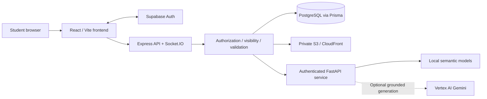

# CampusConnect

**The Digital Student Ecosystem ? discover, collaborate and reconnect on campus.**

CampusConnect is a university-project monorepo bringing student exchange, lost-item recovery, project collaboration, campus services and communication into one application. It combines a responsive React interface, a permission-aware Express API, PostgreSQL persistence and a separate FastAPI AI/ML service.

## Project overview

The core student journey is to discover relevant campus opportunities, evaluate real records and take an authorized action. Light/Dark themes, accessible controls and mobile navigation provide a consistent experience across the modules. Public landing highlights are a separate, sanitized, owner-opt-in projection; signed-in content is not automatically public.

This repository is provided for project evaluation and local development. It does not include a hosted deployment, student database, service credentials, uploaded media or local model weights. Implemented source code and passing isolated tests are not a guarantee of production readiness in every environment.

## Problem statement

Student communities often coordinate through disconnected chat groups and informal notices. Listings become difficult to discover, lost belongings lack a structured recovery workflow, project recruitment is fragmented, and service requests lose context. CampusConnect provides dedicated workflows and centralized discovery while retaining ownership, visibility and privacy boundaries.

## Objectives

- Make campus listings, reports, projects and services easier to discover.
- Support accountable student-to-student collaboration and communication.
- Assist Lost & Found discovery using semantic relevance without claiming ownership.
- Provide grounded campus guidance with source links and truthful fallbacks.
- Preserve authentication, role checks, moderation and private-data boundaries.
- Deliver a coherent, responsive and accessible student experience.

## Functional modules

| Module                                  | Implemented capabilities                                                                                                                           |
| --------------------------------------- | -------------------------------------------------------------------------------------------------------------------------------------------------- |
| Public website and authentication       | Landing page, consented featured highlights, Supabase registration/login, Google OAuth flow, verification and password recovery                    |
| Home and Dashboard                      | Authenticated discovery, account-specific summaries and navigation                                                                                 |
| Marketplace                             | Browse/search, supported filters, pagination, listing details/gallery, create/edit, owner lifecycle controls, bookmarks and sharing                |
| Lost & Found                            | Lost/found reports, discovery/filtering, owner controls, possible matches and permission-aware claims                                              |
| TeamUp                                  | Project discovery, recruitment details, applications, membership and owner management                                                              |
| Campus Services                         | Service discovery, details, provider management, service requests, provider accept/reject and completion workflows subject to existing permissions |
| Messaging                               | Contextual conversations, participant authorization, encrypted message storage, read state and Socket.IO synchronization                           |
| Notifications and Search                | Account-scoped notifications and cross-module discovery                                                                                            |
| Student Profile                         | Public/owner views, profile editing and professional details; professional persistence and photo storage have separate readiness gates             |
| Campus Assistant                        | Temporary conversations, workflow guidance, authorized retrieval, source citations and optional grounded Gemini generation                         |
| Settings, Moderation and Administration | User settings and protected role-dependent management interfaces; administration also has a server-side allowlist                                  |

These are implemented code paths, not claims that every integration is enabled in an examiner's environment. Authentication, database migrations, runtime permissions, media configuration and feature gates must be configured independently.

## AI/ML features

- **Lost & Found matching:** local sentence-transformer embeddings with category/location/time signals, bounded candidate ranking and a baseline fallback. Results are possible leads, not proof of ownership or recovery.
- **Marketplace and TeamUp recommendations:** semantic scoring behind the backend's authorized candidate selection.
- **Campus Assistant:** deterministic product/workflow help, bounded retrieval, MiniLM reranking, safe source navigation and optional Vertex AI Gemini summaries. Personal-loss queries distinguish FOUND reports from LOST reports. Exact team-size answers require actual metadata; ambiguous requests clarify first.
- **Resume analysis:** bounded document extraction and skill-oriented analysis through the protected backend integration.
- **Experimental multimodal evaluation:** optional dependencies and synthetic evaluation tooling are separate from the default runtime. Their presence does not mean every experiment is enabled in the application.

The browser does not call FastAPI directly. FastAPI has no application database connection; Express performs authentication, authorization, candidate selection and response validation. Service-to-service authentication must remain enabled.

**Gemini generation requires separately configured Google Cloud Vertex AI access and Application Default Credentials (ADC), and may incur charges.** Installing or testing this repository does not require a paid generation request. Keep `CAMPUS_ASSISTANT_ENABLED=false` unless generation is deliberately approved/configured. Never publish ADC files or service-account keys.

## Technology stack

| Layer       | Technologies                                                                                 |
| ----------- | -------------------------------------------------------------------------------------------- |
| Browser     | React 19, TypeScript, Vite, React Router, Tailwind CSS, Inter and Manrope                    |
| API         | Node.js, Express 5, TypeScript, Socket.IO, runtime input validation                          |
| Identity    | Supabase Auth, JWT verification, database-backed roles/authorization                         |
| Persistence | PostgreSQL, Prisma 7, PostgreSQL driver/adapter                                              |
| Media       | Private AWS S3 storage and CloudFront delivery when configured                               |
| AI/ML       | Python, FastAPI, sentence-transformers/MiniLM, scikit-learn, Google Gen AI SDK for Vertex AI |
| Quality     | Node test runner/tsx, pytest, ESLint, TypeScript, Prettier, isolated Chrome fixtures         |

Exact npm versions are recorded in `package-lock.json`; Python dependency specifications are in `ai-service/requirements*.txt`.

## System architecture



This diagram describes service relationships, not a deployed hosting configuration. API modules separate routes, controllers, services and persistence access. AI evidence is minimized before leaving Express; generated citations are reconstructed against authorized evidence. Messaging encryption protects stored content at the application layer; it is not end-to-end encryption.

## Repository structure

```text
CampusConnect/
  frontend/
    public/                 Static public assets and SPA redirects
    src/app/                Routing and authenticated application shell
    src/components/         Shared presentation primitives
    src/features/           Module pages, clients and feature styles
    tests/                  Frontend regression tests and Chrome fixtures
  backend/
    prisma/schema.prisma    Application data model
    prisma/migrations/      Active ordered migration history
    prisma/migration-archive/ Historical reference; not deployment history
    src/modules/            Domain APIs, services and repositories
    src/integrations/       AI and external-service clients
    tests/                  Unit, HTTP and opt-in isolated database tests
  ai-service/
    app/                    FastAPI routes, models, matching and generation
    tests/                  Isolated pytest suite
    evaluation/             Evaluation scripts and recorded experiment outputs
    datasets/               Dataset documentation
    requirements*.txt       Runtime, development and optional dependencies
  docs/                     Architecture and milestone/readiness documentation
  package.json              npm workspace scripts
  package-lock.json         Reproducible npm dependency resolution
```

Some documents record earlier milestone states. The current source, environment gates and latest module readiness reports take precedence over historical plans. Local screenshots/reports referenced by absolute Windows paths are evidence from the author's machine and are not bundled releases.

## Prerequisites

- Node.js **20.19+** and npm **10+**, as declared by the workspace.
- Python **3.11+**, with a Python/platform combination supported by the pinned dependencies.
- PostgreSQL for normal persisted application behavior; Supabase Auth configuration for real sign-in.
- PostgreSQL 17 tools/server only when running explicitly approved disposable database integration tests.
- Optional AWS media infrastructure and optional Google Cloud Vertex AI configuration for their respective integrations.

Semantic models may need an initial download and sufficient local resources. Do not commit model caches. Redis is a future scaling option, not a required dependency of the current local startup.

## Local installation and setup

From the repository root:

```powershell
npm ci
Copy-Item frontend/.env.example frontend/.env
Copy-Item backend/.env.example backend/.env
Copy-Item ai-service/.env.example ai-service/.env

py -m venv ai-service/.venv
ai-service/.venv/Scripts/python.exe -m pip install -r ai-service/requirements-dev.txt
```

Run the copy commands only when the destination files do not already exist; preserve existing private configuration. On other operating systems use the corresponding `python3 -m venv` command and `.venv/bin/python` path. Installation is a user setup step; no dependency installation or cloud provisioning is performed by publication.

Prisma client code is generated locally:

```powershell
npm run prisma:generate
npm run prisma:validate
```

Normal application use requires an approved database with the reviewed schema/migrations. First identify the exact target, its existing migration history, backup and runtime permissions. Review [database guidance](docs/database.md) and the migration history before separately authorizing deployment. Do not run `migrate dev`, `db push`, reset, seed or deploy commands against a shared database merely to try the UI. Demo seeding/media scripts are explicit write operations and never required for tests or publication.

## Environment configuration

The root `.env.example` is a reference, not a shared runtime environment. Each service reads its own configuration.

| File              | Configuration                                                                                                                                 |
| ----------------- | --------------------------------------------------------------------------------------------------------------------------------------------- |
| `frontend/.env`   | `VITE_API_BASE_URL`, public app URL, Supabase project URL and **publishable** key                                                             |
| `backend/.env`    | `DATABASE_URL`, optional `DIRECT_URL`, Supabase verification settings, encryption key, internal AI-service secret and optional media settings |
| `ai-service/.env` | The same `AI_SERVICE_API_KEY`, inference limits and optional Vertex generation settings                                                       |

Important boundaries:

- `VITE_*` values are public browser configuration. Never place database passwords, service-role keys, JWT signing secrets, encryption keys or internal-service secrets there.
- Generate a dedicated random `AI_SERVICE_API_KEY` (at least 16 characters) and use the same value in Express and FastAPI. It is not a Supabase user token.
- `MESSAGE_ENCRYPTION_KEY` must be a stable, private Base64-encoded 32-byte key. Losing/replacing it can make existing messages unreadable. Do not reuse the sample/test values.
- `DIRECT_URL` is for approved migration/metadata access; verify its intended database before use. Do not use a transaction-mode pooler for database backup operations.
- Set `AI_SERVICE_ENABLED=false` to disable Express-to-AI integration; deterministic Assistant guidance remains available.
- `CAMPUS_ASSISTANT_ENABLED=false` disables Gemini generation in FastAPI. To enable it deliberately, configure `GOOGLE_CLOUD_PROJECT`, `GOOGLE_CLOUD_LOCATION`, `GOOGLE_GENAI_USE_VERTEXAI=true`, `GEMINI_MODEL` and ADC outside the repository.
- `PROFILE_PROFESSIONAL_STORAGE_READY` and `PROFILE_PHOTO_STORAGE_READY` default to false in templates. They require separate schema/permission/infrastructure verification; do not toggle them just to dismiss a disabled-state message.
- Real secrets, local test credential files, ADC files, database exports and browser profiles must stay outside Git. Safe `.env.example` templates are included.

## Frontend, backend and AI-service startup

After configuring the required private environments:

```powershell
# Frontend + Express
npm run dev

# Or all three services on Windows (requires the Python virtual environment)
npm run dev:all
```

Alternatively, start individual services in separate terminals:

```powershell
npm run dev:frontend
npm run dev:backend
ai-service/.venv/Scripts/python.exe -m uvicorn app.main:app --app-dir ai-service --reload --host 127.0.0.1 --port 8001
```

Local defaults:

| Service  | Address                                                   |
| -------- | --------------------------------------------------------- |
| Frontend | `http://localhost:5173`                                   |
| Express  | `http://localhost:3000` (`/health`, `/api`)               |
| FastAPI  | `http://localhost:8001` (`/health`, `/ready`, `/version`) |

For real authentication, configure Supabase's allowed local redirects for the existing callback and recovery routes; see [Google/authentication setup](docs/google-authentication.md). Startup alone does not prove database permission or AI readiness. The semantic model must finish loading, and the two service secrets must agree.

## Testing and validation

Ordinary checks from the root:

```powershell
npm run test --workspace frontend
npm run lint
npm run typecheck
npm run format:check
npm run prisma:validate
npm run build
```

`npm test` includes backend opt-in database suites. **Do not run it with inherited test database URLs or approval flags unless database writes are explicitly authorized.** For a read-only publication validation session, use a fresh PowerShell process with private dotenv loading disabled and all `*_TEST_DATABASE_URL`, test approval flags, `DIRECT_URL`, `PG*`, provider and cloud credentials removed. Set an unreachable synthetic loopback `DATABASE_URL`, disable AI generation/integration, and run the non-database backend suites:

```powershell
# Run only after isolating the test environment as described above.
Set-Location backend
$testFiles = Get-ChildItem tests -Filter '*.test.ts' |
  Where-Object { $_.Name -notmatch 'postgres' } |
  ForEach-Object { $_.FullName }
npx tsx --test @testFiles
Set-Location ..

Set-Location ai-service
.venv/Scripts/python.exe -m pytest tests -q
Set-Location ..
```

Pytest fixtures isolate private provider configuration. Do not run optional live-generation smoke scripts for ordinary validation. PostgreSQL and HTTP/database runners create or mutate synthetic records and require their documented target/hash/approval gates in a verified disposable local database; they are not setup shortcuts. Never point them at Supabase or production.

Chrome fixture scripts in `frontend/tests/` test actual rendered components with clearly isolated synthetic boundaries. They require an existing compatible Chrome installation and an external artifact directory. Their screenshots do not prove real student-session or production-data behavior. See individual readiness reports for commands, exclusions and visual acceptance limits.

## Current implementation status

The modules listed above have frontend/backend implementations and regression coverage. Recent work includes the responsive application shell, Marketplace/Lost & Found/TeamUp/Services workflows, messaging reliability, professional-profile and photo-editor readiness, and measured Assistant layout/retrieval corrections.

Useful evidence and operational guidance:

- [Assistant layout and retrieval verification](docs/campus-assistant-step14c-readiness.md)
- [Messaging release blockers and safeguards](docs/messaging-release-blockers.md)
- [TeamUp security readiness](docs/teamup-security-readiness.md)
- [Services integration readiness](docs/services-final-readiness.md)
- [Professional persistence hardening](docs/professional-persistence-hardening.md)
- [Profile photo readiness](docs/profile-photo-readiness.md)
- [AI-service documentation](ai-service/README.md)

Passing isolated tests establishes the behaviors covered by those tests. It does not automatically approve a production database migration, storage activation, deployment, real mobile-device behavior or UI screenshot acceptance.

## Known limitations

- Real operation depends on separately configured authentication, database permissions and optional media/AI integrations. Templates deliberately disable sensitive optional features.
- Assistant context is temporary and bounded; retrieval is a candidate search, not an exhaustive catalog scan. It cannot confirm Lost & Found ownership or invent missing team-size metadata.
- Gemini responses are model-dependent and may be unavailable, time out or incur quota/billing limits. Core guidance and safe fallbacks remain distinct from generated answers.
- External media, credentials, real student records and local evidence screenshots are not included.
- Some membership/application data uses JSON structures; consult concurrency/readiness reports for remaining integrity considerations before production deployment.
- Physical mobile keyboard behavior, native browser zoom and authenticated user-session visual acceptance require their own checks.
- No production throughput, availability, AI accuracy percentage or deployed URL is claimed here.

## Future scope

Potential future work, subject to separate design and security approval:

- Broader accessibility, physical-device and examiner acceptance testing.
- Representative load tests and deployment-specific monitoring.
- Redis-backed coordination/realtime scaling where justified.
- Further measured retrieval evaluation and responsible AI quality improvements.
- Operational rollout of optional profile/media capabilities after permission and recovery checks.

These are directions for future work, not claims of completed deployment or guaranteed performance.

## Project team

| Student      | Enrollment number |
| ------------ | ----------------- |
| Aryan Dahiya | 11023210008       |
| Tejas        | 11023210028       |

## Supervisor and university

**Supervisor:** Ms. Namrata Sukhija

**Institution:** SRM University Delhi-NCR, Sonepat, Haryana.
