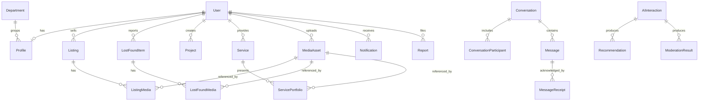

# CampusConnect database architecture

## Overview

CampusConnect uses one normalized PostgreSQL database as its transactional system of record. Prisma ORM 7 provides the schema, migrations, generated types, and query client. UUIDs are used for public entity identifiers, timestamps use timezone-aware PostgreSQL values, and foreign keys use PostgreSQL enforcement rather than Prisma-only emulation.

The initial schema supports the future product domains without implementing their controllers, authentication, realtime delivery, AI calls, or analytics processing.

## Main domains and models

| Domain               | Models                                                                                                               |
| -------------------- | -------------------------------------------------------------------------------------------------------------------- |
| Identity and profile | `User`, `Profile`, `Department`, `Skill`, `UserSkill`, `Interest`, `ProfileInterest`, `Achievement`, `PortfolioLink` |
| Marketplace          | `MarketplaceCategory`, `Listing`, `ListingMedia`, `ListingBookmark`                                                  |
| Lost & Found         | `LostFoundCategory`, `LostFoundItem`, `LostFoundMedia`, `LostFoundClaim`, `LostFoundBookmark`, `LostFoundMatch`      |
| TeamUp               | `Project`, `ProjectSkill`, `ProjectMember`, `ProjectApplication`, `ProjectInvitation`, `ProjectBookmark`             |
| Skills & Services    | `ServiceCategory`, `Service`, `ServiceSkill`, `ServicePortfolio`, `ServiceBooking`, `ServiceBookmark`, `Review`      |
| Messaging            | `Conversation`, `ConversationParticipant`, `Message`, `MessageReceipt`, `MessageAttachment`                          |
| Shared platform      | `MediaAsset`, `Notification`, `Report`                                                                               |
| AI support           | `AIInteraction`, `Recommendation`, `ModerationResult`                                                                |
| Operations           | `ActivityEvent`, `AuditLog`                                                                                          |

`UserRole` is an enum because `STUDENT`, `MODERATOR`, and `ADMIN` are a small authorization vocabulary controlled by the application. A role table would add joins and mutable semantics without a current requirement. Authentication secrets and password fields are intentionally absent; verification readiness is represented only by email addresses and verification timestamps.

Reputation and average ratings are not stored on profiles because they are derived from reviews. They can be queried, materialized, or cached later when measured traffic justifies it.

## Concise ER overview



Join models preserve many-to-many integrity and allow relationship-specific fields such as ordering, proficiency, membership role, and read timestamps.

## Integrity and constraints

- Identity, taxonomy names, and email addresses use PostgreSQL `citext` with unique constraints for case-insensitive uniqueness.
- Prices and quoted amounts cannot be negative; currencies must be three uppercase letters.
- Ratings and proficiency values are bounded from 1 to 5. AI scores are bounded from 0 to 1.
- Marketplace and service reviews each have context-specific foreign keys and per-context duplicate prevention.
- Claims, applications, invitations, memberships, bookmarks, skills, and media links use composite uniqueness or composite primary keys where duplicates have no meaning.
- A project can have at most one active `OWNER` membership. Creating the project and owner membership must occur in one transaction.
- Conversation context, report targets, recommendation targets, moderation targets, and review targets have database `CHECK` constraints over typed nullable foreign keys.
- Cross-row rules—such as ensuring a lost-item match connects a `LOST` row to a `FOUND` row, or ensuring a reviewer participated in the relevant transaction—must be enforced in future transactional services because ordinary row checks cannot inspect referenced rows safely.

Several checks are expressed directly in the initial SQL migration because Prisma Schema Language does not represent them. Future migrations must preserve these constraints when affected tables change.

## Relationship and delete behavior

Critical authored and moderated content generally uses `RESTRICT`, preventing accidental hard deletion of users or content that still has history. Pure membership/link records such as bookmarks, skill joins, and media joins use `CASCADE`. Optional actors and contextual links that must survive independently, such as audit actors and AI interaction links, use `SET NULL`.

The application should normally deactivate users through `User.deletedAt` and `AccountStatus`, not hard-delete them. Listing, project, service, lost/found, review, and message visibility is represented by explicit status or deletion fields so moderation and conversation history can be retained.

Soft deletion is limited to entities where recovery, moderation, or external-object cleanup justifies it:

- `User.deletedAt` for account deactivation/anonymization workflows.
- `Message.deletedAt` for conversation history and moderation.
- `MediaAsset.deletedAt` for coordinated S3 cleanup.
- Domain content uses explicit lifecycle statuses rather than a redundant generic deletion flag.

## Polymorphic relation decisions

Prisma and PostgreSQL cannot enforce a foreign key whose destination table is selected by a `targetType` column. CampusConnect therefore does not use generic polymorphic IDs for mutable domain relationships.

- Bookmarks have separate typed join tables for listings, projects, services, and lost/found items.
- Media uses one `MediaAsset` table plus typed attachment/join tables.
- Reports, contextual conversations, recommendations, moderation results, and reviews have a finite set of nullable typed foreign keys. SQL `CHECK` constraints require the correct number of targets.
- Notifications store optional JSON context and an action URL because they are immutable delivery snapshots, not authoritative ownership records.
- Activity and audit records intentionally store snapshot context. `AuditLog.entityType/entityId` supports investigation after a target is removed and is not presented as a foreign-key relationship.

If another target domain is added, it requires a reviewed schema migration rather than silently accepting an arbitrary type string.

## Media and S3 strategy

`MediaAsset` stores only S3-compatible metadata: a unique object key, media/MIME type, byte size, dimensions, checksum, original filename, uploader, and lifecycle timestamps. PostgreSQL never stores binary media. Typed join tables connect an asset to listings, lost/found items, service portfolios, and message attachments; profiles can reference one avatar.

The permanent database reference is the object key. CloudFront URLs should be constructed or signed using deployment configuration because CDN domains and access policy can change. Object upload, authorization, virus scanning, and S3 deletion are intentionally future service concerns.

## AI persistence strategy

- `AIInteraction` records provider/model, feature, status, latency, usage, and optional request/response text for traceability. API keys are never stored.
- `LostFoundMatch` links two real items and stores a score and explainable rationale.
- `Recommendation` links a user to exactly one real listing, project, or service and records score, reasons, lifecycle, and expiry.
- `ModerationResult` links to exactly one supported content row and stores the decision, scores, and reasons.

AI records enhance core entities rather than copying their titles, owners, or lifecycle state. Request/response text may contain personal information and therefore needs access control and a retention policy before AI features launch.

## Indexing strategy

Indexes are tied to anticipated access paths:

- Users: unique verified email; role/status and status/creation for administration.
- Profiles: department/year for campus discovery and aggregate analysis.
- Listings: seller/status, category/status/creation, and status/creation for feeds and filters.
- Lost & Found: reporter/status and type/status/category/date; status/location/date for discovery.
- Projects: creator/status, status/deadline, and status/creation.
- Services and bookings: provider/category/status, customer/status, and service/status timelines.
- Messaging: participant user membership and `(conversationId, createdAt)` message history.
- Notifications: `(recipientId, readAt, createdAt)` supports unread inbox queries.
- Reports: status/creation and moderator/status support moderation queues; each typed target is indexed.
- Reviews: reviewed user/status/creation plus unique context keys.
- AI: feature/status/time, user/status/time, decision/time, and status/score.
- Analytics/audit: event/action/entity plus timestamp enables bounded chronological queries.

Composite primary and unique keys already provide useful left-prefix indexes; duplicate indexes on the same leading columns are avoided. Full-text/trigram indexes are deferred until search queries and language requirements are defined.

## Migration and client workflow

The migration uses a direct database connection when `DIRECT_URL` is set, falling back to `DATABASE_URL`. For Supabase, runtime traffic can use a pooled `DATABASE_URL` while migration commands use the direct connection.

```bash
npm run prisma:validate
npm run prisma:generate
npm run db:seed
npm run db:migrate:dev -- --name <change-name>
npm run db:migrate:deploy
```

Never reset a shared database. Review generated SQL, especially foreign-key actions, custom checks, and any data transformation, before applying it.

Prisma 7 database seeding is explicit and does not run automatically with migrations. `npm run db:seed` idempotently creates or normalizes the twelve application-managed Marketplace categories by their unique names and slugs. Managed categories are top-level and active. The seed never deletes categories or modifies unrelated records; it stops on ambiguous name/slug conflicts so an operator can resolve them deliberately.

The reusable client in `backend/src/database/prisma.ts` uses Prisma's PostgreSQL driver adapter and a development global cache to avoid duplicate clients during hot reload. Pool size and connection timeout come from validated backend environment configuration.

## Scaling considerations

- Keep API instances stateless and size each instance's PostgreSQL pool so aggregate connections remain below Supabase limits.
- Use the provider's pooled runtime URL and reserve direct connections for migration/administrative work.
- Paginate chronological tables by stable indexed keys; avoid unbounded offset scans as data grows.
- Apply retention/partitioning only after `ActivityEvent`, `AuditLog`, `Notification`, or message volume demonstrates the need.
- Add query monitoring and production-like load tests before claiming the 500–1,000 concurrent-user target.
- Introduce caching or search infrastructure only for measured bottlenecks; PostgreSQL remains authoritative.
